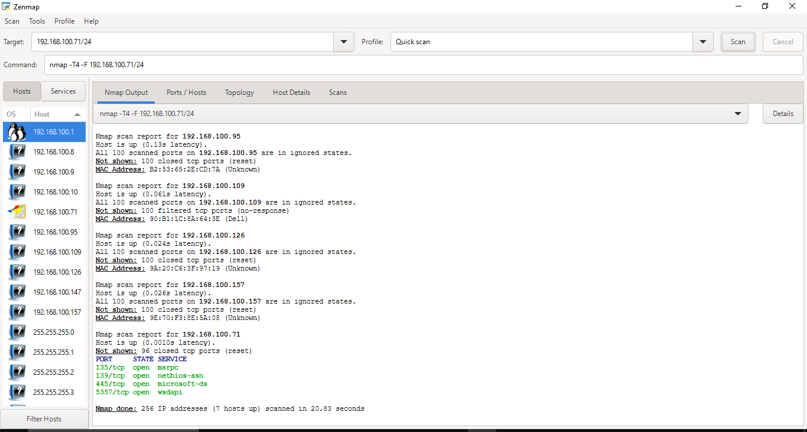
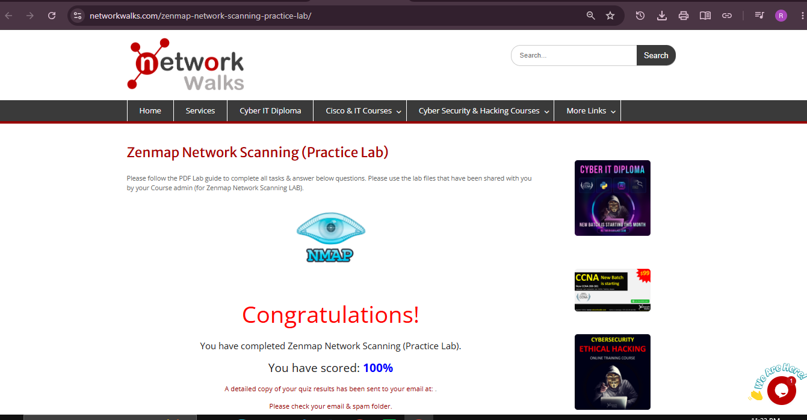
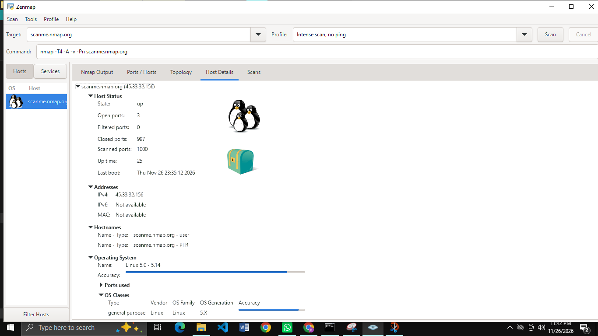
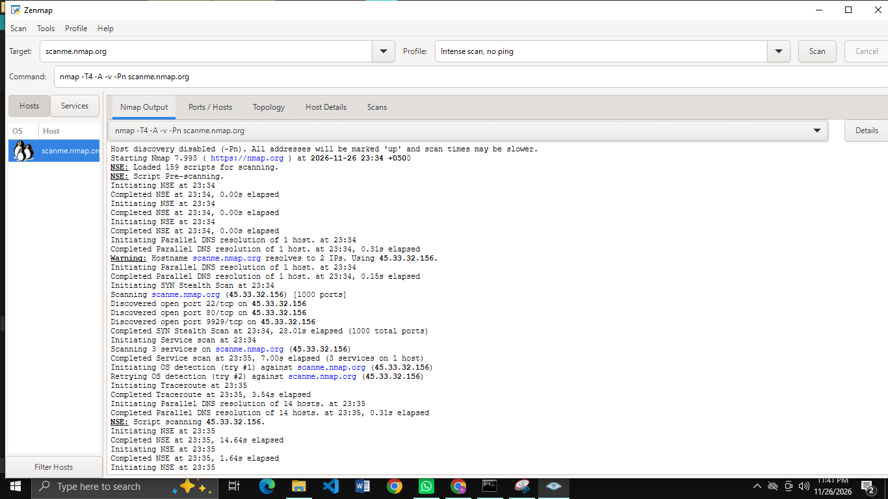
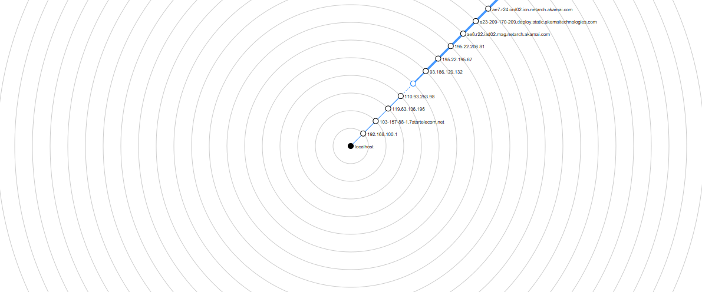

# NetworkWalks-Internship-Week2
Hands-on cybersecurity internship projects covering Footprinting &amp; Reconnaissance using Kali Linux tools and Network Scanning using Zenmap.

**Cybersecurity Internship | Network Walks**

**Intern:** Romaisa Khan  
**Week:** 02  
**Modules:** W2-PM1 and W2-PM5

---

## Overview

This repository contains the practical work completed during Week 2 of my cybersecurity internship at Network Walks.

The projects cover two major areas:

1. Footprinting and Reconnaissance using multiple Kali Linux tools.
2. Network Scanning and Network Discovery using Zenmap.

Screenshots and practical evidence are included to document the tasks performed.

---

# Module 1: W2-PM1 – Footprinting & Reconnaissance

## Objective

To gather information about a target domain using different footprinting and reconnaissance tools available in Kali Linux.

## Tools Used

- WHOIS
- WhatWeb
- Nslookup
- cURL
- Wafw00f
- DNSRecon

## Practical Evidence

### 1. cURL Command

### 2. Nslookup

### 3. DNS SRV Records

### 4. WAF Detection

### 5. WhatWeb Scan

### 6. WHOIS Lookup

# Module 2: W2-PM5 – Network Scanning with Zenmap

## Objective

To discover live hosts on my local network, identify their IP and MAC addresses, and understand network topology using Zenmap.

## Tools Used

- Zenmap
- Nmap
- Windows Command Prompt
- Kali Linux

## Practical Evidence

### 1. Nmap Installation

### 2. Nmap Lab Completed

### 3. Operating System Details

### 4. Network Scanning Practice

### 5. My Network Topology

### 6. Practice Task Topology

---
## Key Learning Outcomes

- Learned the fundamentals of footprinting and reconnaissance.
- Practiced gathering domain and DNS information.
- Explored web technologies and WAF detection.
- Learned to use Nmap and Zenmap for network scanning.
- Identified live hosts on a local network.
- Practiced identifying IP and MAC addresses.
- Understood network topology and host discovery.

---

## Disclaimer

All activities were performed for educational and internship purposes. Network scanning was limited to an authorized practice environment and my own local network. Reconnaissance activities were conducted within the scope of the assigned internship tasks.

---

## Author

**Romaisa Khan**  
Cybersecurity Intern – Network Walks

[Connect with me on LinkedIn](https://www.linkedin.com/in/romaisa-khan11/)

